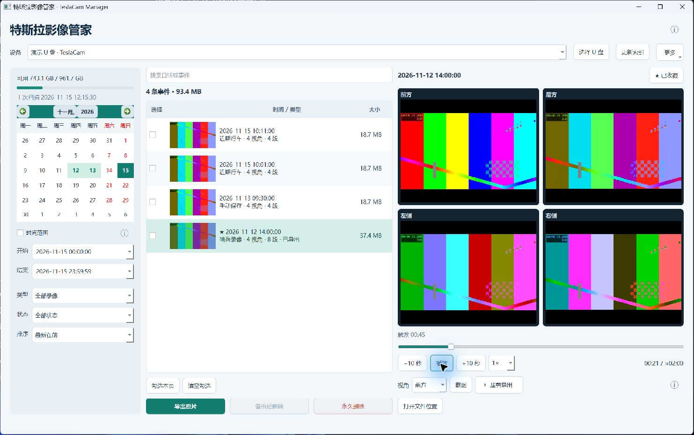
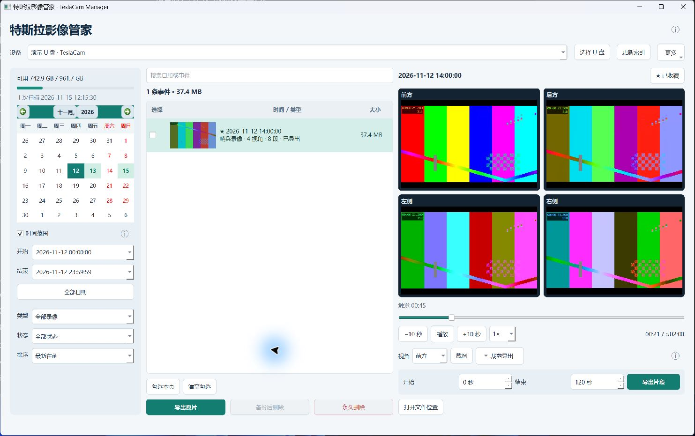

# TeslaCam Desk · 特斯拉影像管家

Windows 桌面工具，C++20 + Qt 6.8 + SQLite + FFmpeg。视频和索引均在本地处理。界面提供中文与英文，跟随系统语言，可在“更多 → 语言”切换。

Windows supported. macOS and Linux planned.

## 下载

[下载 v0.1.0 Windows x64 ZIP](https://github.com/leecus/teslacam-desk/releases/download/v0.1.0/TeslaCamDesk-v0.1.0-windows-x64.zip) · [版本说明](https://github.com/leecus/teslacam-desk/releases/tag/v0.1.0)

下载 Release 中的 `TeslaCamDesk-v0.1.0-windows-x64.zip`，完整解压后运行 `TeslaCamManager.exe`。运行库和 FFmpeg 已包含在包内。

## 截图

截图使用生成的演示视频，不包含真实行车画面。





## 使用

启动 `bin\TeslaCamManager.exe`，保留 bin 中的运行依赖文件。

1. 点击“选择 U 盘”，选择 U 盘根目录或 TeslaCam 目录，也可选择电脑上的录像副本。选择目录不会自动扫描。
2. 点击“扫描建索引”。首次枚举目录后建立基础索引，显示文件数、耗时和估计剩余时间。每 100 个文件提交一次索引，可取消；再次点击更新会重新枚举，复用已完成的文件记录。未完成的扫描不会清理旧索引，也不会改写上次完成时间。
3. 基础索引完成后生成当前页的缩略图；之后可在“更多”中选择“生成本页预览”。生成预览时可继续浏览和筛选，也可以取消。列表每页 100 条。
4. 通过日历、时间范围、录像类型、收藏/导出状态、日期和目录关键字查询。时间筛选按事件整体返回，不截掉其他摄像头。
5. 点击事件多路预览，支持倍速、跳转、跨片段播放、双击视角全屏、Esc 退出全屏。缺失片段显示空档，无法解码会提示错误。截图使用“视角”选择框中的摄像头。
6. 不勾选时，操作针对当前事件；勾选后针对所有勾选事件。切换筛选时清除不再显示的勾选，避免操作隐藏结果。
7. “导出原片”保留整个事件的原始 MP4 和所在目录中的 JSON/JPG/PNG 信息，不转码；目标为带时间和随机编号的新目录，附 SHA-256 校验清单。仅完整成功的事件标为已导出。中途取消保留已经完成的备份文件。
8. 展开“裁剪导出”并点击“导出片段”，按事件时间轴上的秒数裁剪所选单摄像头，输出 1280×720 H.264 MP4（保持比例、必要时加黑边、无音频）。处理前读取实际片段时长，缺片或覆盖不足会拒绝导出，最终核对输出时长。这是观看版，不替代原始录像。
9. 收藏事件受本工具删除保护。清理以事件为单位，删除前列出数量和预估释放空间，需明确确认永久删除；不经过回收站。删除前核对磁盘身份、文件大小及修改时间。文件变化时跳过整条事件并提示更新索引。只删除索引内的录像，不递归删除目录，事件元数据保留。
10. “备份后删除”要求备份目标在另一磁盘，所有所选事件的原片与信息完整备份并校验成功后才开始删除。取消或备份失败不开始删除；删除阶段取消会保留尚未处理的文件。文件系统操作不具备整批撤销能力，断盘或删除权限失败时可能部分完成，结果会记录已完成数量。

## 分组与索引

- `SentryClips`、`SavedClips` 按文件父目录归为事件。
- `RecentClips` 按同一目录内的本地文件时间划分为固定十分钟组，事件的 tooltip 中注明推断分组。
- 支持文件名 `yyyy-MM-dd_HH-mm-ss-camera.mp4`，大小写扩展名均可，动态识别摄像头名称；不符合格式时退回文件修改时间和 unknown 视角。
- 基础扫描不对每个视频解码，时间轴在片段未载入时以约 60 秒估计，播放时逐步校正；裁剪导出会读取真实时长。
- 元数据可读时显示 event.json 中 timestamp 对应的触发点。无元数据时不生成触发时间或地点。
- 索引、缩略图和操作日志位于 `%LOCALAPPDATA%\LocalTools\TeslaCamManager`。可通过界面打开。环境变量 `TESLACAM_DATA_DIR` 可覆盖该位置，用于测试。
- 使用 Windows 卷 GUID/序列号和卷内录像目录识别设备，盘符变化后重新选择相应目录即可匹配。不能只凭设备名称识别；复制/克隆了卷标识的磁盘仍可能有歧义。
- 离线可查索引和缩略图；播放、导出、删除需要原设备。外部软件或车机改变内容后须主动更新索引。收藏保护只对本工具生效。
- 不跟随符号链接或目录联接。目录枚举失败时保留已有索引，不将读取失败误认为文件全部消失。

## 本地构建

需要 Windows x64、Visual Studio C++ x64 工具、CMake/Ninja 和 Qt 6.8 MSVC SDK。默认使用本机 VS 18 Community 的工具路径；其他环境可从 MSVC 开发者 PowerShell 中通过 PATH 提供工具并调整 build.ps1 的 VS 路径。

```powershell
.\setup-dev.ps1
.\build.ps1
```

setup-dev 仅在项目 .deps 中准备 Python 虚拟环境和 Qt SDK。build.ps1 编译、运行核心及视频集成测试，并将运行依赖放入本地 bin；不创建便携目录、ZIP 或安装包。

测试覆盖事件分组、完整事件时间筛选、增量与完整扫描、中断恢复、原片校验与元数据备份、导出状态失效、收藏保护、变化文件拒删、设备不匹配、路径越界、跨片段精确裁剪、缺片拒绝和取消处理。视频测试使用生成画面，不使用真实行车记录。

开发运行参数：`--source "E:\TeslaCam"` 只选择目录，不自动扫描；`--smoke-test` 启动窗口后自动退出；`--theme light|dark` 指定外观；`--lang zh|en` 指定界面语言；`--screenshot out.png` 渲染窗口后退出。

标题栏右侧的 ☀/☾ 切换浅色与深色外观，“更多 → 语言”切换中文与英文；两项选择都保存在本地设置中，未设置时跟随系统配色与语言。浅色以中性灰为主，深色为暗色面板，两者共用同一套青色强调色。

## 多语言

中文是源语言，界面文本按原样写在代码里；英文译文位于 `i18n/teslacam_en.ts`，构建时由 `lrelease` 编译并内嵌进可执行文件，因此发布包不需要额外的语言文件。

- 新增或修改界面文本时，先在代码中写成 `tr("中文")`（模型层用 `QCoreApplication::translate("Cam", …)`），再在 `i18n/teslacam_en.ts` 补上对应 `<message>`。
- 译文缺失时自动回退到中文，不会出现空白。
- 需要重新提取条目时用 Qt 的 `lupdate`；当前开发用的精简 SDK 未包含 `lupdate` 依赖的 Qt6Qml，若要在本机运行它，先 `aqt install-qt … -m qtdeclarative` 装上该模块。
- 切换语言会重建界面以重新翻译，当前设备、筛选条件、勾选和分页会被保留；有后台任务运行时禁止切换。

## 当前范围

已实现本地索引、时间查询、多路预览、原片导出、单视角裁剪、截图、收藏和手动批量清理。暂不包含地图、图像内容识别、多摄像头拼接导出和自动清理。尚需用真实车型/U 盘样本验证命名、编码及事件元数据差异。

## 发布包

用户明确要求发布时，使用 `python package-release.py --version 0.1.0` 生成版本化的 Windows x64 ZIP。准备材料位于 `.deps/release-sources/`：Qt 6.8.3 三个模块的源码归档、FFmpeg 7.1 与 9.0.2 源码、Gyan 的原始 essentials ZIP，以及 DirectX Shader Compiler 的许可文件。来源 URL 见脚本。脚本校验 FFmpeg 与上游原包一致，收集动态运行库及许可材料，并生成逐文件清单和 SHA-256 校验文件；同版本的历史包不会被覆盖。

使用 `python tests/verify_release.py dist/TeslaCamDesk-v0.1.0-windows-x64.zip` 校验 ZIP、文件清单、x64 DLL 依赖，并在含中文及空格的临时路径、隔离 PATH 的环境中启动应用、创建 SQLite 索引和验证 FFmpeg 编解码。

第三方依赖：Qt 动态链接（LGPL-3.0）、SQLite、Qt 多媒体使用的 FFmpeg 7.1 动态库（LGPL-2.1-or-later），以及独立调用的 FFmpeg 9.0.2 命令行程序（GPL-3.0-or-later）。发布包附许可文本、模块 SBOM、构建信息与来源索引；相关源码归档在同一 Release 提供下载。
