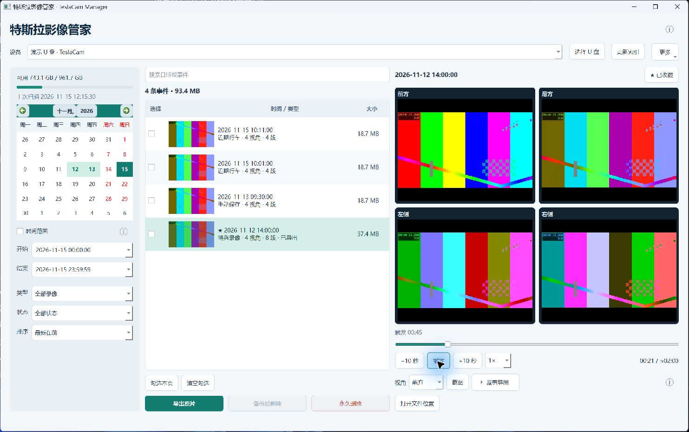

首个 Windows x64 预览版。

[下载 Windows x64 ZIP（约 65 MiB）](https://github.com/leecus/teslacam-desk/releases/download/v0.1.0/TeslaCamDesk-v0.1.0-windows-x64.zip)

完整解压后运行 `TeslaCamManager.exe`，选择录像 U 盘，再点击“扫描建索引”。已包含 Qt、FFmpeg 和 MSVC 运行库。

- 手动扫描、增量索引与中断后继续更新。
- 按日期、时间、录像类型和收藏状态查询。
- 多摄像头同步预览、倍速播放、截图与单视角裁剪。
- 整个事件的原片备份与 SHA-256 校验。
- 收藏保护、批量清理，以及备份校验成功后删除。

永久删除不经过回收站，无法撤销。首次使用建议先对录像副本操作。

验证环境：Windows 11 x64。已通过核心与视频集成测试、ZIP 和逐文件哈希校验、40 个 EXE/DLL 的依赖检查，以及独立中文路径、隔离 PATH 下的启动和 FFmpeg 编解码验证。真实车型录像格式仍需更多样本验证；macOS 与 Linux 暂未提供发行包。

`TeslaCamDesk-v0.1.0-SHA256SUMS.txt` 提供安装包及第三方源码归档的校验值。第三方许可、模块 SBOM、构建配置和源码索引已随 ZIP 提供；同页的 Qt / FFmpeg `.tar.xz` 附件为对应源码归档。

